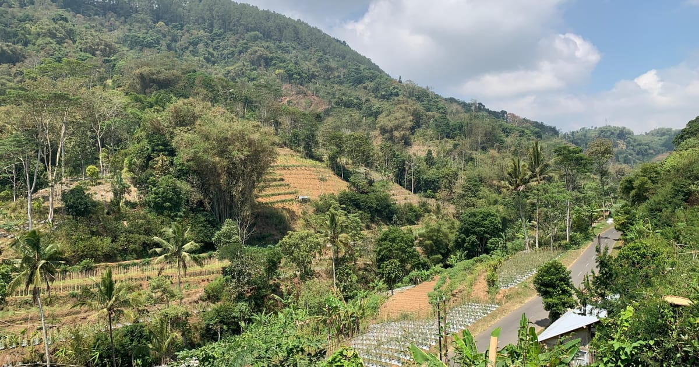

# Dusun Sukomangun

Situs profil resmi **Dusun Sukomangun**, Desa Genito, Kecamatan Windusari, Kabupaten Magelang, Jawa Tengah.

🌐 **Kunjungi:** [dusunsukomangun.vercel.app](https://dusunsukomangun.vercel.app)



Situs satu halaman ini mengenalkan sejarah, alam, warga, tradisi, dan kesenian Sukomangun — dusun di kawasan pegunungan yang namanya bermakna *senang membangun, tanpa menunda*.

## Isi halaman

| Bagian | Isi |
|---|---|
| **Beranda** | Potensi dusun dan galeri foto yang bergeser otomatis |
| **Tentang** | Tokoh pembuka lahan, masa penjajahan Belanda, asal nama |
| **Geografi** | Batas wilayah dengan dusun tetangga |
| **Peta** | Lokasi di Google Maps dan akses jalan |
| **Penduduk** | Jumlah rumah, mata pencaharian, dan UMKM warga |
| **Tradisi** | Diba'an, Mujahadah, Ziarah Kubur, Maulid, Tahlilan, Ruwahan |
| **TPQ** | Sejarah, pengajar, dan materi TPQ Darul Huda |
| **Fasilitas** | Masjid dan Posyandu |
| **Kesenian** | Al Montra Montro / Sabillun Najah dan Telogo Suto |

## Mengubah isi situs

📖 **Baca [PANDUAN.md](PANDUAN.md)**: langkah demi langkah mengganti teks, foto, kontak WhatsApp, dan titik peta lewat browser, tanpa perlu memasang aplikasi apa pun.

Ringkasnya:

- Teks dan foto setiap bagian ada di folder [`components/`](components/), satu file per bagian halaman.
- Kontak kepala dusun, titik peta, dan alamat situs dikumpulkan di [`lib/site.ts`](lib/site.ts).
- Setiap cabang (*branch*) otomatis mendapat alamat pratinjau dari Vercel; cabang `main` langsung tayang di situs utama.

## Menjalankan di komputer sendiri

Butuh [Node.js](https://nodejs.org) 20 atau lebih baru dan [pnpm](https://pnpm.io).

```bash
pnpm install
pnpm dev
```

Lalu buka [http://localhost:3000](http://localhost:3000). Untuk memeriksa hasil akhir sebelum diunggah, jalankan `pnpm build`.

## Teknologi

[Next.js 16](https://nextjs.org) (App Router) · React 19 · Tailwind CSS 4 · ikon [Lucide](https://lucide.dev) · di-hosting di [Vercel](https://vercel.com)

## Struktur folder

```
app/            Tata letak halaman, metadata SEO, sitemap, robots.txt
components/     Satu file per bagian halaman, plus galeri & bingkai foto
lib/            Data penting (kontak, titik peta, alamat situs) dan fungsi bantu
public/images/  Foto yang tampil di situs
```
